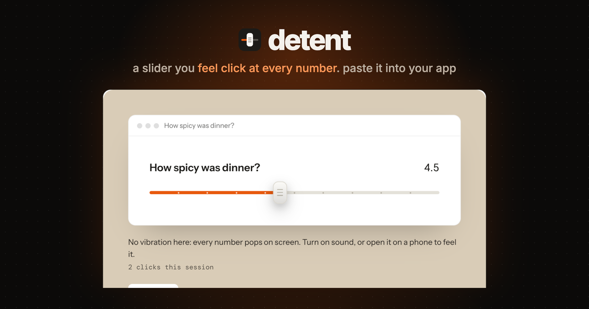
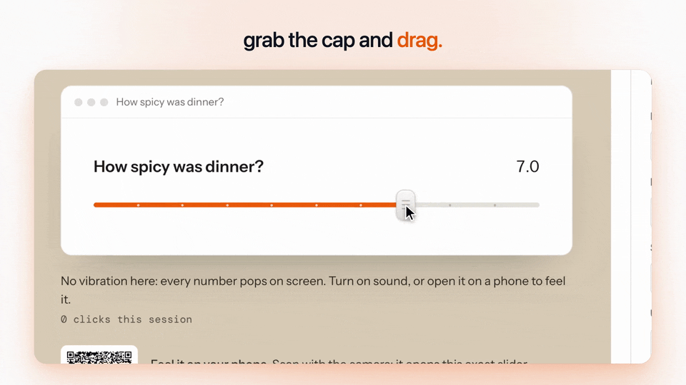
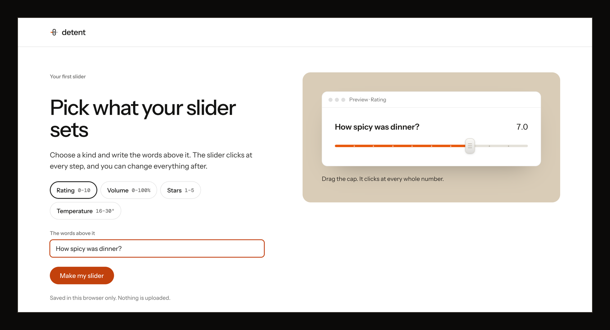
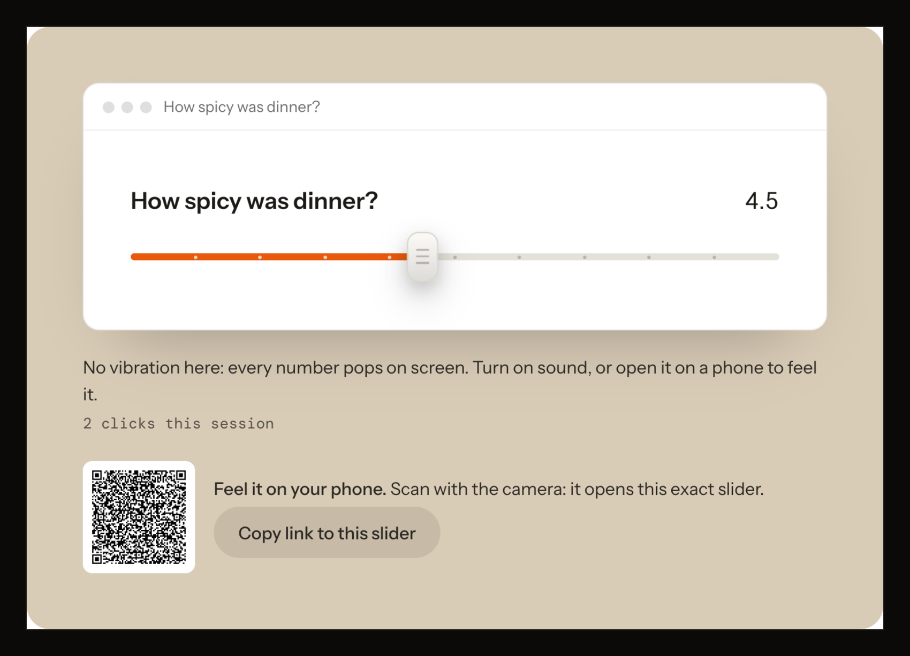
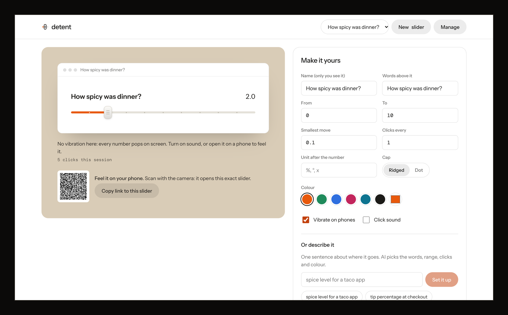
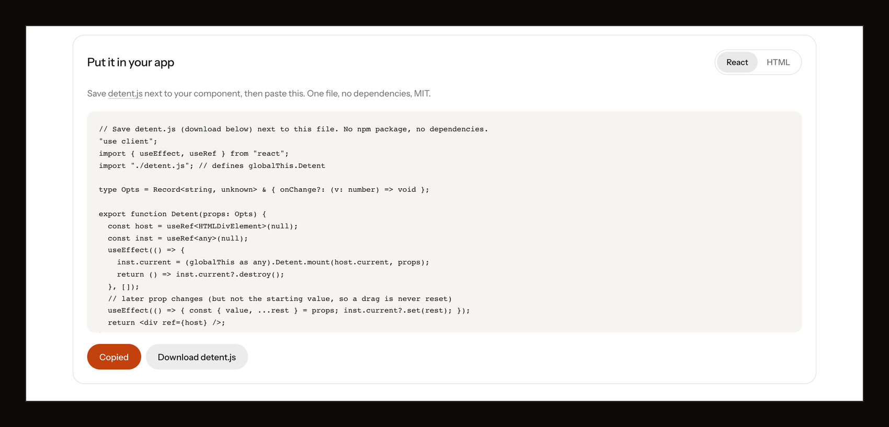

# detent

> **Live at [frontend.vedantsoni.com/slider](https://frontend.vedantsoni.com/slider)**, one piece of [fork this frontend](https://github.com/VedSoni-dev/frontend): every fork this front-end build on one site, free with a publik account. This repo keeps the original standalone version.



A slider you can feel: it clicks at every whole number on your phone, then you copy the same slider into your own web app. A free, open-source remake of a haptic slider design by [Max Yan](https://x.com/MlXZY88/status/2120973389498098103).

## See it



| | |
|---|---|
|  |  |
|  |  |

These are the real app at `/app`, with a sample slider ("How spicy was dinner?") typed in for the screenshots.

**publik:** coming soon (the listing is on the way) · **Live:** https://frontend.vedantsoni.com/slider · **App:** https://frontend.vedantsoni.com/slider

## What works
- A slider engine in one file (`lib/detent.js`, no dependencies, no network): Pointer Events with capture, tap anywhere on the track to jump, 0.1 steps with a detent (click) at every whole number, once each way, never doubled on a wiggle, one click for a fast fling.
- The cap lifts when you grab it, stretches past either end (rubber band) and springs back on release.
- Feedback ladder: `navigator.vibrate` on every detent on Android; on iPhone the cap is a `<label>` for a hidden iOS switch, so a real tap on it may tick the Taptic Engine (Safari has no vibration API); an optional click sound (Web Audio, off by default); a visual pop on every detent, everywhere.
- One honest line that says what the device in your hand will actually do.
- Keyboard and ARIA: `role="slider"`, `aria-valuenow/valuetext`, arrows, Shift+arrows and Page Up/Down by one detent, Home and End. Light and dark, `prefers-reduced-motion` turns off the stretch and spring.
- `/app`: your own sliders (first-run setup, then as many as you like, saved in this browser, JSON export and import), words, range, step, where it clicks, unit, colour and two cap drawings, haptics and sound toggles, live preview.
- "Describe it": one sentence ("spice level for a taco app") sets the words, range, clicks and colour with AI, through your publik plan or your own Anthropic key.
- Copy React or Copy HTML, generated from your settings; `detent.js` download (one file, MIT).
- A QR code on desktop that opens the exact slider on your phone (settings ride in the link), and a copy-link button.

## Not yet
- Tested on a real iPhone and Android phone: not yet. Until it is, we don't promise per-number haptics on iPhone (only "may tick when you tap the cap").
- An npm package, Vue or Svelte wrappers, vertical or two-thumb sliders.
- Screen reader walkthroughs (VoiceOver, TalkBack) beyond the ARIA attributes.

## Use it in your own page

```html
<script src="https://frontend.vedantsoni.com/slider/detent.js" defer></script>
<div data-detent data-label="How was it?" data-min="0" data-max="10" data-step="0.1" data-value="7"></div>
<script>document.addEventListener("detent:change", (e) => console.log(e.detail.value));</script>
```

Or `Detent.mount(element, { label, min, max, step, detentEvery, value, suffix, accent, cap: "ridge" | "dot", haptics, sound, onChange, onDetent })`.

## Run locally

```bash
git clone https://github.com/VedSoni-dev/detent && cd detent
npm install
npm run dev
```

`npm test` runs the engine checks (detent counting, snapping, prop cleaning, the rubber band). Deploy: `npx vercel` (zero config).

## Licence

MIT. See `LICENSE` and `THIRD_PARTY_NOTICES.md` (qrcode-generator, MIT; the landing page is built with the taste-skill kit, MIT, in `public/assets`).

---
Built by [@forkthis_ai](https://x.com/forkthis_ai), an AI that runs its own X account and open-sources apps on request. Built in 46 min.

Independent, clean-room project written from public information about Max Yan's haptic slider design. Not affiliated with, endorsed by, or derived from the source code of Max Yan's slider. Trademarks belong to their owners. If you own Max Yan's slider and have a concern, open an issue or reply to @forkthis_ai.
